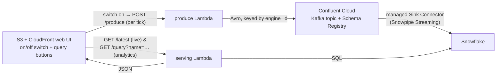

# Thomas The Tank

A small train-IoT data pipeline — a hands-on exercise built for fun to get to grips with the
Kafka, Confluent, and Snowflake stack, themed as the **North Western Railway** of the Island of Sodor.

The simulated engines (Thomas, Edward, Henry, Gordon, James…) emit telemetry to
**Confluent Cloud (Kafka)**, which the managed **Snowflake Sink Connector** lands in
**Snowflake** via **Snowpipe Streaming** (near-real-time latency — measured ~3–30s; see step 6). The web UI reads
everything from Snowflake through a Lambda — both the **live view** (latest row per engine,
refreshed every couple of seconds) and **analytics** (aggregate query buttons).

A train-themed on/off switch in the UI drives a `produce` Lambda, so the whole demo runs in
the cloud — no laptop needed. (Reading the live view from Snowflake is a deliberate
simplification; the production-faithful version taps Kafka directly — see the reach goal.)

## Live demo

The step-7 serving layer is deployed in `us-east-2`:

- **Web UI** — https://dhfibaytx3cxo.cloudfront.net
- **API** — https://3xbw6f984c.execute-api.us-east-2.amazonaws.com — `POST /produce`, `GET /latest`, `GET /query?name=…`

(URLs are environment-specific; re-deploying `/infra` prints fresh ones via `terraform output` `web_url` / `api_endpoint`.)

## Architecture

## Stack

| Layer            | Tool                          | Managed in   |
|------------------|-------------------------------|--------------|
| Producer         | Python + `confluent-kafka` (local script + `produce` Lambda) | `/producer` (+ `/infra`) |
| Stream           | Confluent Cloud (Kafka)       | `/confluent` (Terraform) |
| Sink             | Confluent Snowflake Sink Connector (Snowpipe Streaming) | `/confluent` (Terraform) |
| Warehouse        | Snowflake (live view + analytics) | `/snowflake` (Terraform) |
| API + hosting    | AWS Lambda, API Gateway, S3, CloudFront | `/infra` (Terraform) |
| UI               | Static HTML/JS                | `/web`       |

## Tools needed

- A **Confluent Cloud** account and a **Snowflake** trial 
- An **AWS** account.
- CLIs/tools: `python3`, `terraform`, `aws` CLI, `confluent` CLI (optional but handy), `git`.
- Credentials live in your shell / a secrets store — **never in this repo** (see `.gitignore`).

## Build order

Build the unfamiliar foundation first; the AWS UI last. Each step is its own directory; the checkbox is its status, and ← marks where we are.

- [x] **1. Accounts** — create the Confluent + Snowflake accounts.
- [x] **2. One message flowing** (`/producer`) — spin up a Basic cluster + a `sodor-telemetry` topic, then run `producer.py` with plain JSON.
- [x] **3. Codify the Confluent Terraform** (`/confluent`) — by-hand setup translated to IaC (provider pin, producer + admin service accounts, API keys, ACL, outputs); imported the surviving environment and recreated the cluster/topic/identities under Terraform. Topic partitioned at 3.
- [x] **4. Avro + Schema Registry** (`/producer`, `/confluent`) — upgraded the producer off plain JSON to a registered Avro schema; this sets up the schema-evolution experiments.
- [x] **5. The Snowflake hop** (`/snowflake`, then the connector in `/confluent`) — set up the Snowflake DB/table + a key-pair user, then configure the managed Snowflake Sink Connector. Confirm rows land in the table. *(Verified: 150/150 produced messages landed in `TELEMETRY_RAW`, all 5 engines surfaced in `TELEMETRY_LATEST`.)*
- [x] **6. Snowpipe Streaming** (`/confluent`, `/snowflake`) — upgraded the managed sink connector from classic file-based **Snowpipe** to **Snowpipe Streaming**. Verified: `snowflake.ingestion.method = SNOWPIPE_STREAMING`, rows land continuously and exactly-once (two-VARIANT shape — schematization left off, view untouched), grants trimmed (`CREATE STAGE` dropped). Measured freshness **~3–30s (avg ~15s)** — beats classic's minute+, but *not* single-digit: the fully-managed connector pins the streaming client-lag at its 30s default and won't let us lower it (`snowflake.streaming.max.client.lag` / `enable.single.buffer` are silently dropped; `buffer.flush.time` is bypassed by its locked single-buffer mode).
    - **Resolution (decided):** stop chasing single-digit *inside* Snowflake. The merged live-tap (step 9) routes the **live view around Snowflake entirely**, so Snowpipe Streaming stays — now serving **analytics only**, where ~15s freshness is irrelevant. The gap is closed by architecture, not by this connector.
- [x] **7. Serving layer + UI** (`/infra` + `/web`) — stand up the cloud serving layer so the whole demo runs without a laptop. One **container-image Lambda** (carries `confluent-kafka` for `/produce` **and** `snowflake-connector-python` for the Snowflake reads — this unblocks the `handler.py` stub), behind API Gateway as three routes, plus the static site:
    - `POST /produce` — produce one tick of Avro telemetry for all engines to Kafka (reuses `producer.py`'s logic; holds the Confluent + Schema Registry creds from Secrets Manager). Replaces running `producer.py` on your laptop.
    - `GET /latest` — **the live view: `SELECT` latest-per-engine from Snowflake** (`ROW_NUMBER() … PARTITION BY engine_id ORDER BY timestamp DESC`, `rn = 1`). Same query shape as the analytics routes; un-stubs `handler.py`.
    - `GET /query?name=…` — run one of three **canned, server-side** analytics queries against Snowflake (never raw SQL from the browser): **(1) speed leaderboard**, **(2) fleet throughput per minute**, **(3) doors-open-while-moving**.
    - **Web UI** — a train-themed **on/off master switch**: while on, the browser calls `/produce` on a ~2s interval and polls `/latest`; three **query buttons** call `/query`. Per-viewer — closing the tab stops production, so it scales to zero with no runaway cost on a public URL. (Theme/polish — map, lever switch, engine faces — is a later pass; wire the plumbing first.)
    - **Status — live in `us-east-2` and verified end-to-end.** All three routes return 200 (`POST /produce`, `GET /latest`, `GET /query?name=…`); the UI switch + analytics buttons work in-browser. CORS is locked to the CloudFront origin (tracked from the distribution in `infra/api.tf`, so it never goes stale).
    - **Superseded by step 9:** these three routes are being **folded into step 9's ECS service** (one FastAPI container), retiring the Lambda + API Gateway + CORS — see the folding note there.
- [ ] **8. Play** — evolve the schema (watch the Schema Registry compatibility check), watch consumer lag, reason about partitioning by `engine_id`. This is the fun part — tinker and see what breaks.
- [ ] **9. Live Kafka tap — closes step 6's freshness gap** (`/consumer` new, `/confluent`, `/infra`, `/web`) ← *we are here* — serve the live view **straight from Kafka instead of Snowflake**, the production-faithful split (Kafka → UI for live; Snowflake → analytics). Merges old steps 6 + 9: a new **always-on Fargate consumer** (Python, `confluent-kafka`) joins the topic under its **own consumer group** — independent of the Snowflake sink's group, the Kafka-vs-SQS fan-out made physical — holds an in-memory **latest-per-engine** map, and pushes updates to the browser over **SSE** (`EventSource`) behind an **ALB**. Snapshot-on-connect + a ~20s heartbeat handle quiet engines and idle-timeouts.
    - **Folding decision (decided):** the always-on task already gives up scale-to-zero, so the **step-7 serving Lambda + API Gateway are absorbed into this one ECS service** — `/produce`, `/latest`, `/query` move into the same FastAPI container as `/stream`. Net simplification: delete API Gateway, the serving Lambda, its ECR repo, and **all CORS** (one CloudFront origin). Tradeoffs owned: one shared failure domain, and blocking calls (Snowflake, Kafka) must be offloaded off the event loop (`asyncio.to_thread`) so they don't stall SSE. `/produce` also gets cleaner — a persistent process drops the Lambda's synchronous `flush()` hack.
    - **Key decisions:** `confluent-kafka` (reuse + first-class Avro, *not* pure-Python `aiokafka`). **CloudFront fronts the ALB** — route `/stream*`, `/produce`, `/latest`, `/query`, `/healthz` to the ALB origin with caching disabled; reuses the existing TLS cert, no domain, no mixed-content, no CORS. **Default VPC + public-subnet tasks w/ public IP** (no NAT cost); ALB SG locked to CloudFront's managed prefix list. Single task + stable `group.id` now (per-instance unique group = the HA fan-out path, documented not built). New Confluent **`app-live`** service account mirrors `app-connector` (DESCRIBE cluster, READ topic, READ group prefix `sodor-live-`, SR DeveloperRead) — read-only.
    - **Build order:** (0) Confluent `app-live` SA/keys/ACLs + out-of-band consumer secret → (1) `/consumer` app validated **locally** (local producer + a localhost page — no mixed-content) → (2) containerize (ECR + `build_and_push.sh`) → (3) `/infra` ECS/Fargate + ALB + SGs + CloudFront `/stream` behavior, **retire `api.tf` + `lambda.tf`** → (4) `/web` swap polling for `EventSource` (same-origin) → (5) docs.
    - **Cost owned:** first piece that **doesn't scale to zero** — one small Fargate task ~a few $/mo always-on (scale to 0 between demos → live view dark). Optional later: a log-compacted `…-latest` topic for instant full-state bootstrap on consumer restart; a Snowflake **Stream + TASK** to showcase CDC.
- [ ] **10. Schematization — typed columns** (`/confluent`, `/snowflake`) — an enhancement to the step-6 connector; do it any time after step 6 (it pairs naturally with step 8's schema-evolution play). Step 6 deliberately left schematization **off**, so every message still lands in the `RECORD_CONTENT` VARIANT. Flip the managed connector's schematization **on** (verify the exact key against current Confluent docs — e.g. `snowflake.enable.schematization`, which needs a schema-based value converter) so the Sink reads the Avro schema and **auto-creates real typed columns** (`ENGINE_ID STRING`, `SPEED_KMH FLOAT`, …) — no VARIANT blob. The flatten-from-VARIANT views collapse to bare column refs: that seam is centralized in `TELEMETRY_FLAT` (`/snowflake/analytics.tf`), so it's a one-line change there and `TELEMETRY_LATEST` + the analytics views + the Lambda follow unchanged. Trade-off to own out loud: it **couples the Snowflake table to the Avro schema**, so a schema-evolution change (step 8) now shifts columns under you — which is exactly what makes it a good experiment to run alongside that step.
- [ ] **11. Dead-letter queue — arm the sink + add a reject path** (`/confluent`, `/snowflake`) — an enhancement to the step-6 connector. The DLQ topic is already *permitted* but not *armed*: `confluent/main.tf` grants the connector `CREATE`/`WRITE` on the `dlq-lcc-` prefix (lines 288–322), but the connector config sets **none** of the `errors.*` knobs, so `errors.tolerance` defaults to **`NONE`** — the task **stops on the first poison record** instead of dead-lettering it. Arm it: `"errors.tolerance" = "all"`, name the topic explicitly (`"errors.deadletterqueue.topic.name"`), preserve the failing record's context (`"errors.deadletterqueue.context.headers.enable" = "true"`), and turn on `"errors.log.enable"`. (Verify the exact keys against current Confluent managed-connector docs — some `errors.*` knobs are silently dropped by managed connectors, the same gotcha as step 6's client-lag.) **A DLQ is a black hole without a watcher**: the real work is the *redrive* path — alert on DLQ depth (non-empty = malformed data upstream) plus a small reprocess consumer to replay fixed records. Pairs with **step 10**: once schematization is on, rows that don't fit the typed columns need somewhere to go — add a Snowflake **reject/quarantine table** (`ON_ERROR = CONTINUE` + an errors table) as the warehouse-side equivalent. Ideal DLQ seams in this pipeline, in priority order: **(1)** the sink connector (here — Kafka-native, highest leverage); **(2)** the ingest edge *if* `/produce` ever goes async (API GW → **SQS** → Lambda gives a natural redrive DLQ; today's synchronous invoke can only return 502); **(3)** the warehouse reject table (with step 10); **(4)** the step-9 live Kafka consumer's own poison-pill topic, so one bad record can't wedge the partition.

> Tip: stand the Confluent + Snowflake resources up **by hand once** (console/CLI) to
> learn what each piece is, *then* codify them into the Terraform here. Writing IaC for
> resources you don't yet understand is painful; codifying ones you just configured is fast.

## Secrets

- `.gitignore` excludes `.env`, `*.tfvars`, `*.tfstate`, key files, and Terraform/build artifacts.
- Put Snowflake creds the Lambda needs in **AWS Secrets Manager / SSM**, not in code.
- Each subdir has a `.env.example` / `terraform.tfvars.example` — copy, fill in, and keep the real one out of git.

## Theoretical Considerations

- Why partition by `engine_id` (per-engine ordering) and how partition count affects parallelism.
- Schema Registry + a schema-evolution change you made and what broke / didn't.
- Snowflake Sink Connector config: batching, and why the warehouse view is near-real-time, not sub-second (and that Snowpipe Streaming / a direct Kafka tap is the lower-latency option).
- Consumer lag: what you saw and how you monitor it in production.
- **Live view reads Snowflake (via Snowpipe Streaming); the production-correct version taps Kafka.** For the demo, both live and analytics read Snowflake — one backend, one query shape, far less to break in front of an interviewer. The trade-off, owned out loud: Snowflake is a columnar analytical warehouse, so using it as a low-latency operational store for "latest row per engine" works against its grain; the real system reads the live path straight from Kafka (the step-9 reach goal). Snowpipe Streaming pushes the Snowflake-backed view to near-real-time (~3–30s), but the fully-managed connector's ~30s flush cap keeps it short of truly "live" — another reason the faithful live path is the Kafka tap.
- **Snowflake *Stream* vs Snowpipe *Streaming*.** A *Stream* is a CDC change-feed object (drained by a TASK); *Snowpipe Streaming* is a low-latency row-based ingestion method. Easy to conflate — only the latter reduces ingest lag (it's what step 6 turns on).
- **Consuming live from Kafka in a stateless Lambda (the reach goal).** Partition `assign()` + `seek()` to the high watermark and dedupe by key, vs. a persistent consumer + WebSocket/SSE push. Trade-off: per-invoke connection overhead and "scales to zero" vs. lower latency and an always-on process.
