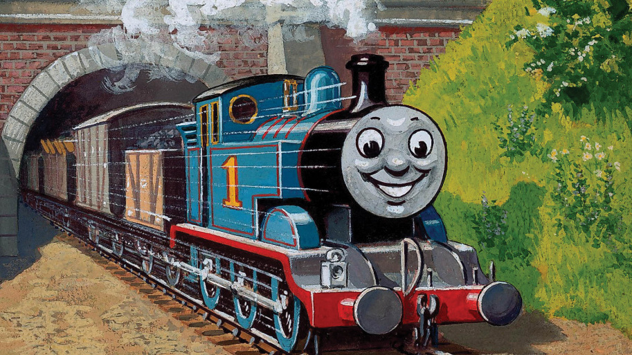
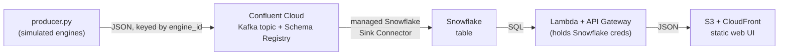

# Thomas The Tank

A small train-IoT data pipeline — a hands-on exercise built for fun to get to grips with the
Kafka, Confluent, and Snowflake stack, themed as the **North Western Railway** of the Island of Sodor.

The simulated engines (Thomas, Edward, Henry, Gordon, James…) emit telemetry →
**Confluent Cloud (Kafka)** → managed **Snowflake Sink Connector** → **Snowflake** table →
**AWS Lambda / API Gateway** → a static **S3 / CloudFront** web UI that shows the engines updating.

## Architecture

## Stack

| Layer            | Tool                          | Managed in   |
|------------------|-------------------------------|--------------|
| Producer         | Python + `confluent-kafka`    | `/producer`  |
| Stream           | Confluent Cloud (Kafka)       | `/confluent` (Terraform) |
| Sink             | Confluent Snowflake Sink Connector | `/confluent` (Terraform) |
| Warehouse        | Snowflake                     | `/snowflake` (Terraform) |
| API + hosting    | AWS Lambda, API Gateway, S3, CloudFront | `/infra` (Terraform) |
| UI               | Static HTML/JS                | `/web`       |

## Tools needed

- A **Confluent Cloud** account and a **Snowflake** trial 
- An **AWS** account.
- CLIs/tools: `python3`, `terraform`, `aws` CLI, `confluent` CLI (optional but handy), `git`.
- Credentials live in your shell / a secrets store — **never in this repo** (see `.gitignore`).

## Build order

Build the unfamiliar foundation first; the AWS UI last. Each step is its own directory; the checkbox is its status, and ← marks where we are.

- [x] **1. Accounts** — create the Confluent + Snowflake accounts.
- [x] **2. One message flowing** (`/producer`) — spin up a Basic cluster + a `sodor-telemetry` topic, then run `producer.py` with plain JSON.
- [x] **3. Codify the Confluent Terraform** (`/confluent`) — by-hand setup translated to IaC (provider pin, producer + admin service accounts, API keys, ACL, outputs); imported the surviving environment and recreated the cluster/topic/identities under Terraform. Topic partitioned at 3.
- [x] **4. Avro + Schema Registry** (`/producer`, `/confluent`) — upgraded the producer off plain JSON to a registered Avro schema; this sets up the schema-evolution experiments.
- [ ] **5. The Snowflake hop** (`/snowflake`, then the connector in `/confluent`) ← *we are here* — set up the Snowflake DB/table + a key-pair user, then configure the managed Snowflake Sink Connector. Confirm rows land in the table.
- [ ] **6. The UI** (`/infra` + `/web`) — deploy the Lambda/API + static site, point the UI at the API.
- [ ] **7. Play** — evolve the schema, watch consumer lag, reason about partitioning by `engine_id`. This is the fun part — tinker and see what breaks.
- [ ] **8. Reach goal** (after everything else) — add a true live-from-Confluent feed (WebSocket/SSE bridge) alongside a separate analytical-query feature over Snowflake.

> Tip: stand the Confluent + Snowflake resources up **by hand once** (console/CLI) to
> learn what each piece is, *then* codify them into the Terraform here. Writing IaC for
> resources you don't yet understand is painful; codifying ones you just configured is fast.

## Secrets

- `.gitignore` excludes `.env`, `*.tfvars`, `*.tfstate`, key files, and Terraform/build artifacts.
- Put Snowflake creds the Lambda needs in **AWS Secrets Manager / SSM**, not in code.
- Each subdir has a `.env.example` / `terraform.tfvars.example` — copy, fill in, and keep the real one out of git.

## Theoretical Considerations

- Why partition by `engine_id` (per-engine ordering) and how partition count affects parallelism.
- Schema Registry + a schema-evolution change you made and what broke / didn't.
- Snowflake Sink Connector config: batching, and why the warehouse view is near-real-time, not sub-second (and that Snowpipe Streaming / a direct Kafka tap is the lower-latency option).
- Consumer lag: what you saw and how you monitor it in production.
